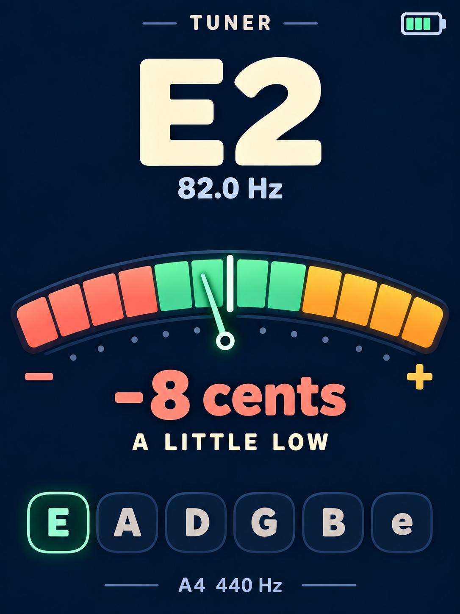

[English](README.md)

# Passport Works

用于 FoloToy AI Passport 的个人离线固件作品集。
这是独立维护的仓库，包含应用和必要的板级支持，不代表 FoloToy 官方作品。

| 作品 | 功能 |
| --- | --- |
| [调音器与节拍器](docs/tuner.zh_CN.md) | 吉他、贝斯、小提琴调音；40–240 BPM 节拍器。 |
| [个人名片](docs/personal-card.zh_CN.md) | 头像名片、电量、亮度控制和自动调暗。 |



这是设计参考，不是经过设备验证的实拍图。

## 构建

需要 ESP-IDF **5.5.3**、Python 3 和主机 C 编译器。
目标为 ESP32-C3、8 MB Flash、无 PSRAM。先激活 ESP-IDF。

```bash
./tools/validate.sh --static
./tools/validate.sh --firmware tuner
./tools/validate.sh --firmware personal-card
./tools/validate.sh
```

完整检查验证两个应用。合并镜像位于
`build/<application>/Passport-Works-full.bin`，匹配调试包位于
`build/<application>/firmware/<sha256>/`。生成物被 Git 忽略。
合并镜像写入 `0x0`，可能重置已有设置。刷写须设备所有者批准，构建不代表设备验证。

参见[开发说明](docs/development.zh_CN.md)、[来源记录](docs/upstream.zh_CN.md)
和[素材及隐私规则](assets/README.zh_CN.md)。
CI 检查两个应用，不自动发布版本或上传产物。

## 许可证

FoloToy 板级支持及改编工具保留[上游 MIT 许可证](LICENSE)。
原创应用源码采用相同许可证。个人头像不进入 Git，仓库再分发许可不包含这些素材。
